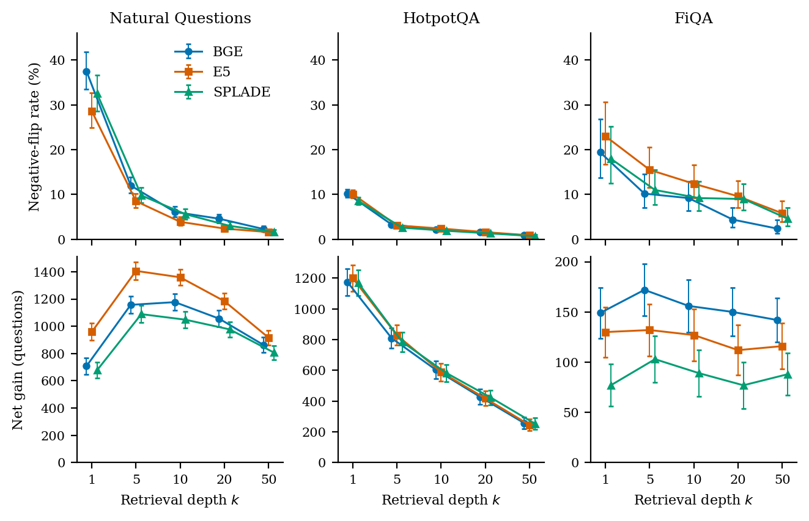

# RAGFlip

Query-level negative flips when one retriever replaces another.

[](https://arxiv.org/abs/2610.07266)
[](https://pypi.org/project/ragflip/)
[](https://pypi.org/project/ragflip/)
[](LICENSE)



Aggregate coverage can rise while some queries that BM25 already supported lose their relevant passage. The figure shows that pattern for BGE, E5, and SPLADE on Natural Questions, HotpotQA, and FiQA.

Run a retrieval change against logged traces. RAGFlip lists the traces that gain support, the traces that lose support, and a recommendation label for that comparison. The application decides which losses are acceptable.

```bash
pip install ragflip
ragflip check traces/ --retriever myapp.search:retrieve --k 8
```

Package: https://pypi.org/project/ragflip/

## Citation

If you use RAGFlip in research, please cite our paper:

> Elyas Irankhah and Muhammad Arif. **RAGFlip: Measuring Query-Level Negative Flips in Retriever Upgrades.** arXiv:2610.07266 [cs.IR], 2026.  
> [https://arxiv.org/abs/2610.07266](https://arxiv.org/abs/2610.07266) · [https://doi.org/10.48550/arXiv.2610.07266](https://doi.org/10.48550/arXiv.2610.07266)

```bibtex
@misc{irankhah2026ragflip,
  title         = {RAGFlip: Measuring Query-Level Negative Flips in Retriever Upgrades},
  author        = {Irankhah, Elyas and Arif, Muhammad},
  year          = {2026},
  eprint        = {2610.07266},
  archivePrefix = {arXiv},
  primaryClass  = {cs.IR},
  doi           = {10.48550/arXiv.2610.07266},
  url           = {https://arxiv.org/abs/2610.07266}
}
```

The logged traces are the before. The retriever you pass is the after. `judge_supported` is that judge's decision for the claim.

## Install

```bash
pip install ragflip
```

Local judges need the optional models:

```bash
pip install "ragflip[local]"
```

## Check a set of traces

Use this before you change `k`, the chunk size, the embedding model, or the reranker.

```bash
ragflip check logged_traces/ --retriever myapp.search:retrieve_v2 --judge overlap
ragflip check logged.jsonl --retriever myapp.search:retrieve --k 8 --out report.json
```

```text
Traces checked: 26
Fixed:     17 / 19 failing traces
Broken:    4 / 7 working traces
Mixed:     1 traces fixed one claim and broke another
Unchanged: 4

Recommendation
REVIEW BEFORE SHIPPING
```

`--k` overrides the logged `top_k`. Each broken trace is listed with the claim that lost support. `--judge` is `llama`, `qwen`, `openai`, `overlap`, `local`, or `module:function`. With no flag, OpenAI is used when `OPENAI_API_KEY` is set. Otherwise the lexical `overlap` judge runs.

## Repair one failure

The repair actions are `increase_k`, `restore_original_query`, `rerank_candidates`, and `merge_retrieved`.

```bash
ragflip repair failure.json --retriever myproject.retrieval:search --judge qwen
```

When the failed claim becomes supported and no previously supported claim breaks, the command prints:

```text
Failed claim
"Paris is the capital of France."

Experiment
increase_k: 1 → 6

Before
unsupported

After
supported

Regression check
0 previously supported claims checked
0 regressions

Recommendation
ACCEPT EXPERIMENT
```

When the same change also breaks a claim that already worked, the command prints `REJECT EXPERIMENT`.

```bash
ragflip repair examples/traces/accept_increase_k.json --retriever examples.demo_retriever:retrieve --judge overlap
ragflip repair examples/traces/reject_increase_k.json --retriever examples.demo_retriever:retrieve --judge overlap
```

The reject trace already supports "The desk lamp uses 40 watts." A wider `k` returns Paris and drops the lamp.

## Your retriever

```python
def retrieve(query: str, k: int):
    return [{"id": "1", "text": "..."}]
```

Pass it as `module:function`.

LangChain:

```python
from ragflip.integrations.langchain import as_retriever, trace

failure = trace("What does the desk lamp use?", chain_result, top_k=1)
failure.save("failure.json")
```

`as_retriever` sets `k` and returns `{id, text}` chunks.

## Trace

```json
{
  "question": "...",
  "answer": "...",
  "retrieved_chunks": [{"id": "r1", "text": "..."}],
  "corpus_chunks": [{"id": "c47", "text": "..."}],
  "metadata": {"retriever": "faiss", "top_k": 4}
}
```

## Wikipedia example

`python -m examples.wiki_demo` runs BM25 at top-1 over 2,067 SQuAD Wikipedia passages and 150 questions, then checks two changes. The gold line is whether the dataset answer string is in the retrieved text.

Replacing BM25 with `all-MiniLM-L6-v2` at the same k:

| | Fixed | Broken |
|---|---:|---:|
| Gold answer string | 13 / 33 missed | 33 / 117 already answered |
| Overlap judge | 12 / 31 failing traces | 31 / 119 working traces |

Packing BM25 top-6 into a 90-word budget fixed 6 answers and broke 93 of the 117 answers BM25 already had. Both checks print `REVIEW BEFORE SHIPPING`.

## Server

`ragflip` with no subcommand prints help. `ragflip serve` starts the local server. See [QUICKSTART.md](QUICKSTART.md).
